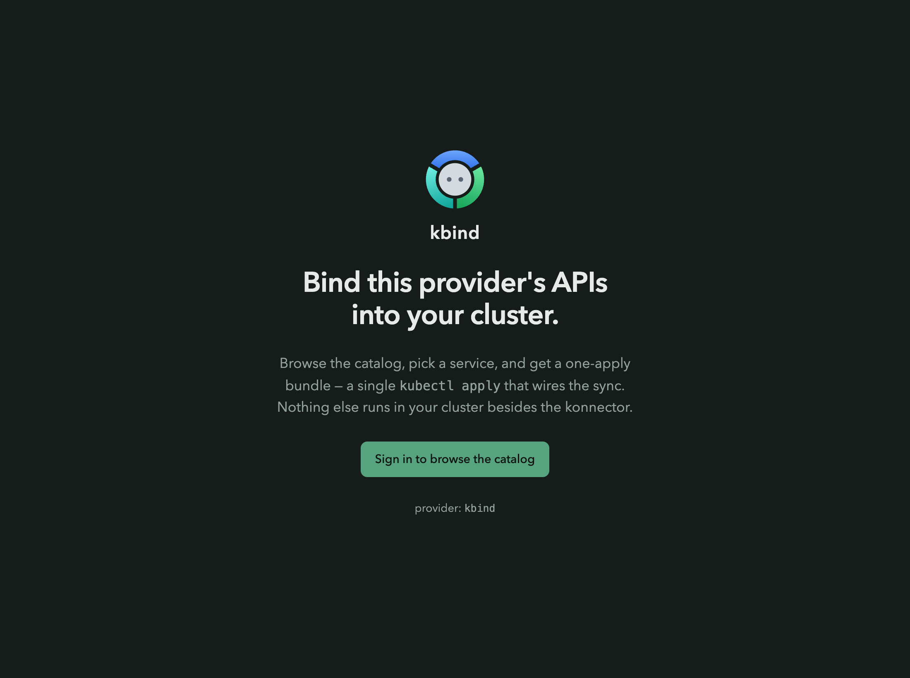
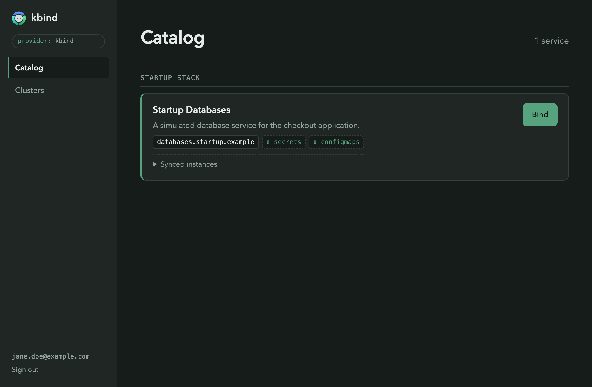
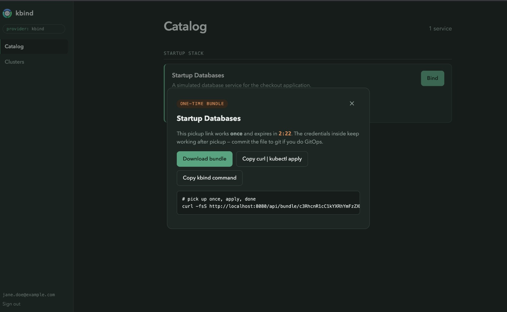
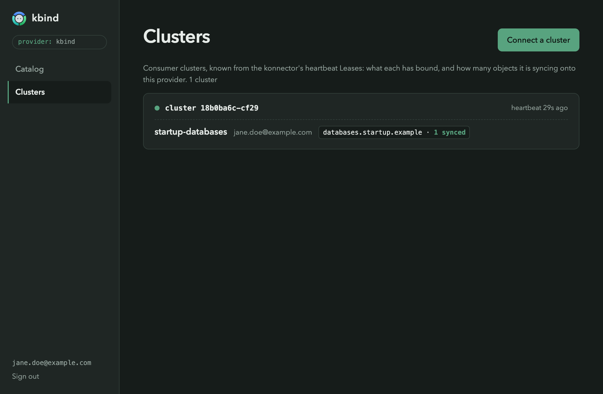

# kbind v2: From Core Sync to Service Onboarding

*Part 2: Publish a service and let the backend handle onboarding.*

In [Part 1](2026-11-24-kbind-v2-getting-started.md), we connected two Kubernetes clusters by supplying provider credentials, a Connection, and a ClusterBinding directly. The konnector sent our `checkout-db` specification to the provider and returned its status to the consumer. That is the core of kbind: consumers work with APIs in their own clusters while providers operate the services elsewhere.

Supplying those inputs manually is useful for learning and automation. A provider serving application teams also needs a way to present its services, authenticate consumers, and issue credentials. The optional backend supplies that workflow. We’ll use the same simulated Database API, this time discovering and binding it through the catalog and CLI.

<!-- more -->

## What the backend adds

Three provider-side APIs describe the service layer:

| Kind | API group | Purpose |
|---|---|---|
| `Export` | `catalog.kbind.io/v1alpha1` | Describe a service offering, its APIs, and binding defaults |
| `Collection` | `catalog.kbind.io/v1alpha1` | Group offerings for browsing |
| `Grant` | `iam.kbind.io/v1alpha1` | Record issued access and the associated credential resources |

The backend combines a gateway for authentication and HTTP requests with an issuer that provisions credentials. Binding an Export creates or updates a Grant, waits for issuance, and returns a bundle containing a Secret, Connection, and ClusterBinding. Those are the same core inputs we supplied in Part 1. The konnector then talks directly to the provider API; the gateway is outside the synchronization path.

## Prepare a fresh environment

Use fresh clusters for this article. Reusing Part 1’s consumer would leave a manual binding managing the same API. You need Docker, kind, kubectl, Git, make, and Go matching `go.mod`.

```bash
git clone --branch v2-next https://github.com/kbind-dev/kbind.git kbind-onboarding
cd kbind-onboarding
git checkout 85d25389c44c57cee5b324eb1559533535f172cc

make backend konnector bind
install -m 0755 bin/bind bin/kubectl-bind
export PATH="$PWD/bin:$PATH"
```

Save these three manifests in the root of this checkout:

| File | Purpose |
|---|---|
| [provider-database.yaml](../assets/kbind-v2-service-onboarding/provider-database.yaml) | Exported Database CRD and static related resources |
| [database-catalog.yaml](../assets/kbind-v2-service-onboarding/database-catalog.yaml) | Database offering and its Collection |
| [checkout-db.yaml](../assets/kbind-v2-service-onboarding/checkout-db.yaml) | Consumer’s Database request |

Run all commands from the checkout root. The example synchronizes a simulated API, not a running database server. Its Secret contains demonstration values, and we’ll patch status to simulate a service controller.

```bash
kind create cluster --name startup-services-provider \
  --kubeconfig "$PWD/services-provider.kubeconfig" --wait 120s
kind create cluster --name startup-services-consumer \
  --kubeconfig "$PWD/services-consumer.kubeconfig" --wait 120s
```

## Start the backend and publish the offering

In a second terminal at the checkout root, start the provider backend:

```bash
KUBECONFIG="$PWD/services-provider.kubeconfig" ./bin/backend \
  --oidc-mock --external-url=http://localhost:8080
```

Leave it running. `--oidc-mock` starts a development identity provider that automatically approves logins. Use a real OIDC configuration for deployments beyond this local exercise. The backend installs its service-layer CRDs; back in the first terminal, wait for them before applying the samples:

```bash
kubectl --kubeconfig=services-provider.kubeconfig wait \
  --for=condition=Established \
  crd/exports.catalog.kbind.io crd/collections.catalog.kbind.io \
  crd/grants.iam.kbind.io --timeout=120s

kubectl --kubeconfig=services-provider.kubeconfig apply \
  -f provider-database.yaml -f database-catalog.yaml

kubectl --kubeconfig=services-provider.kubeconfig wait \
  --for=condition=Ready \
  exports.catalog.kbind.io/startup-databases --timeout=120s
```

Open `database-catalog.yaml`. The Export `startup-databases` selects `databases.startup.example` and supplies defaults for copying the credentials Secret and settings ConfigMap from the provider. The Collection `startup-stack` groups that offering for browsing. Collections do not grant access or bind their members as a unit.

Export readiness confirms that the named CRD exists and has the export label. It does not mean a database controller is running or that an individual database is healthy. Related-resource selectors choose what to synchronize; they do not narrow the issued RBAC to those labels. The default cluster-wide issuer grants Secret reads across provider namespaces for this offering, so use a disposable provider and review [credential scope](../../developers/backend/index.md#credential-scope-and-installer-privileges) before adapting it to shared infrastructure.

## Prepare the consumer

Install the core definitions:

```bash
kubectl --kubeconfig=services-consumer.kubeconfig apply \
  -f sdk/config/crd/core.kbind.io_connections.yaml \
  -f sdk/config/crd/core.kbind.io_clusterbindings.yaml \
  -f sdk/config/crd/core.kbind.io_bindings.yaml

kubectl --kubeconfig=services-consumer.kubeconfig wait \
  --for=condition=Established \
  crd/connections.core.kbind.io crd/clusterbindings.core.kbind.io \
  crd/bindings.core.kbind.io --timeout=120s
```

In a third terminal at the checkout root, start the konnector:

```bash
KUBECONFIG="$PWD/services-consumer.kubeconfig" ./bin/konnector
```

Both processes run on the workstation because these kubeconfigs use host-mapped endpoints. We have not copied the provider administrator kubeconfig into a consumer Secret. The backend will issue a service-account credential when we bind the offering.

## Log in and bind the service

Open `http://localhost:8080` in your browser. The landing page introduces the provider and offers a **Sign in to browse the catalog** button. Click it to continue. With `--oidc-mock`, sign-in automatically approves the demo identity and takes you to the catalog; no username or password is required. A backend configured with a real OIDC provider redirects you to that provider’s login flow instead.

[](../assets/kbind-v2-service-onboarding/login.png)

*The browser entry point before authentication. All screenshots in this article use dark mode. The live UI follows your browser’s light or dark color preference.*

Browser and CLI sessions are separate. To follow the terminal workflow, return to the first terminal and authenticate the CLI as well:

```bash
kubectl bind login http://localhost:8080
kubectl bind catalog
```

The CLI login command opens a browser for authentication and saves its own session. The catalog should include `startup-databases`, titled **Startup Databases**, in **Startup Stack**. You can also browse the catalog at `http://localhost:8080`.

[](../assets/kbind-v2-service-onboarding/catalog.png)

*The offering shows its API and the related Secrets and ConfigMaps selected for provider-to-consumer copying.*

```bash
kubectl bind export startup-databases \
  --kubeconfig=services-consumer.kubeconfig \
  --install-konnector=false
```

The konnector is already running, so we skip installation. The CLI requests a binding, redeems a one-time bundle URL, and applies the generated objects to the consumer. Unlike Part 1, we do not author a Connection, binding manifest, or provider credential Secret ourselves.

The browser’s **Bind** button offers the same bundle through a download dialog:

[](../assets/kbind-v2-service-onboarding/binding-bundle.jpeg)

*The browser offers a one-time bundle download and copy commands. A downloaded bundle contains credentials; encrypt its Secret or use a secret manager before storing it in Git.*

## Inspect what was created

Inspect both sides without exposing credentials:

```bash
kubectl --kubeconfig=services-provider.kubeconfig get grants.iam.kbind.io
kubectl --kubeconfig=services-consumer.kubeconfig get connections,clusterbindings
```

The gateway generates a Grant name from the Export and authenticated identity. That name is also used for the consumer Connection, ClusterBinding, and kubeconfig Secret. There is one Grant in this fresh provider; capture its name for the remaining commands:

```bash
GRANT=$(kubectl --kubeconfig=services-provider.kubeconfig \
  get grants.iam.kbind.io -o jsonpath='{.items[0].metadata.name}')

kubectl --kubeconfig=services-consumer.kubeconfig wait \
  --for=condition=Ready connection/"$GRANT" clusterbinding/"$GRANT" \
  --timeout=120s

kubectl --kubeconfig=services-consumer.kubeconfig wait \
  --for=condition=Established crd/databases.startup.example --timeout=120s
```

The issuer provisions the Grant’s service account, token, and RBAC on the provider. The consumer Secret contains the issued kubeconfig. The core engine uses it to discover and synchronize APIs, independently of the CLI session.

## Request the database and verify synchronization

```bash
kubectl --kubeconfig=services-consumer.kubeconfig apply -f checkout-db.yaml

kubectl --kubeconfig=services-provider.kubeconfig -n default wait \
  --for=create database/checkout-db --timeout=120s
kubectl --kubeconfig=services-provider.kubeconfig -n default wait \
  --for=jsonpath='{.spec.storageGB}'=10 database/checkout-db --timeout=120s

kubectl --kubeconfig=services-provider.kubeconfig -n default \
  patch database checkout-db --subresource=status --type=merge \
  -p '{"status":{"phase":"Ready"}}'

kubectl --kubeconfig=services-consumer.kubeconfig -n default wait \
  --for=jsonpath='{.status.phase}'=Ready database/checkout-db --timeout=120s
kubectl --kubeconfig=services-consumer.kubeconfig -n default get databases
```

Expected output:

```text
NAME          PLAN      STORAGEGB   PHASE
checkout-db   starter   10          Ready
```

The offering’s defaults also activate related-resource copying. Verify that the copies belong to this generated binding:

```bash
kubectl --kubeconfig=services-consumer.kubeconfig -n default wait \
  --for=create secret/checkout-db-credentials configmap/checkout-db-settings \
  --timeout=120s
kubectl --kubeconfig=services-consumer.kubeconfig -n default get \
  secret/checkout-db-credentials configmap/checkout-db-settings \
  -o 'custom-columns=NAME:.metadata.name,BINDING:.metadata.annotations.core\.kbind\.io/related-binding'
kubectl --kubeconfig=services-consumer.kubeconfig get clusterbinding "$GRANT" \
  -o jsonpath='{.metadata.uid}{"\n"}'
```

Both `BINDING` values should match the ClusterBinding UID. These are static provider resources selected by the Export’s defaults, not credentials generated by a database operator.

For a provider-side inventory, try:

```bash
kubectl bind clusters
kubectl bind instances startup-databases
```

Cluster visibility follows the konnector’s heartbeat, so allow time for the first renewal. These inventories help locate connected consumers and synchronized objects; use resource status and the checks above to assess the actual service state.

[](../assets/kbind-v2-service-onboarding/connected-cluster.png)

*The Clusters view shows the connected consumer, its bound offering, and one synchronized Database.*

## Clean up access and resources

A login session, a one-time bundle URL, and an issued provider credential have separate lifetimes. Session expiry does not revoke the service-account credential. Deleting an Export does not revoke existing Grants either. Delete a Grant while the issuer is running to remove its provisioned credentials.

For this disposable exercise, keep both host processes running while draining the consumer first:

```bash
kubectl --kubeconfig=services-consumer.kubeconfig -n default \
  delete database checkout-db --timeout=120s
kubectl --kubeconfig=services-provider.kubeconfig -n default wait \
  --for=delete database/checkout-db --timeout=120s
kubectl --kubeconfig=services-consumer.kubeconfig \
  delete clusterbinding "$GRANT" --timeout=120s
kubectl --kubeconfig=services-consumer.kubeconfig \
  delete connection "$GRANT" --timeout=120s
kubectl --kubeconfig=services-provider.kubeconfig \
  delete grants.iam.kbind.io "$GRANT" --timeout=120s
```

Then stop the backend and konnector with Ctrl-C and remove the clusters and kubeconfigs:

```bash
kind delete cluster --name startup-services-consumer
kind delete cluster --name startup-services-provider
rm services-consumer.kubeconfig services-provider.kubeconfig
```

The CLI caches its localhost session in the platform’s kbind config file; deleting the clusters does not remove that session entry. See [CLI session storage](../../usage/catalog.md#cli-sessions-and-cluster-selection) and the [credential lifecycle guide](../../usage/catalog.md#revoke-and-retire-an-offering) when adapting this workflow.

## From manual inputs to onboarding

Part 1 made the synchronization inputs visible by creating them directly. Here, the backend produced them after authentication and service selection. The consumer still declared `checkout-db` locally, the provider still received its specification, and status still returned through the konnector. Choose direct manifests for automation or the backend for a catalog and credential-issuance workflow; both lead to the same core objects.
